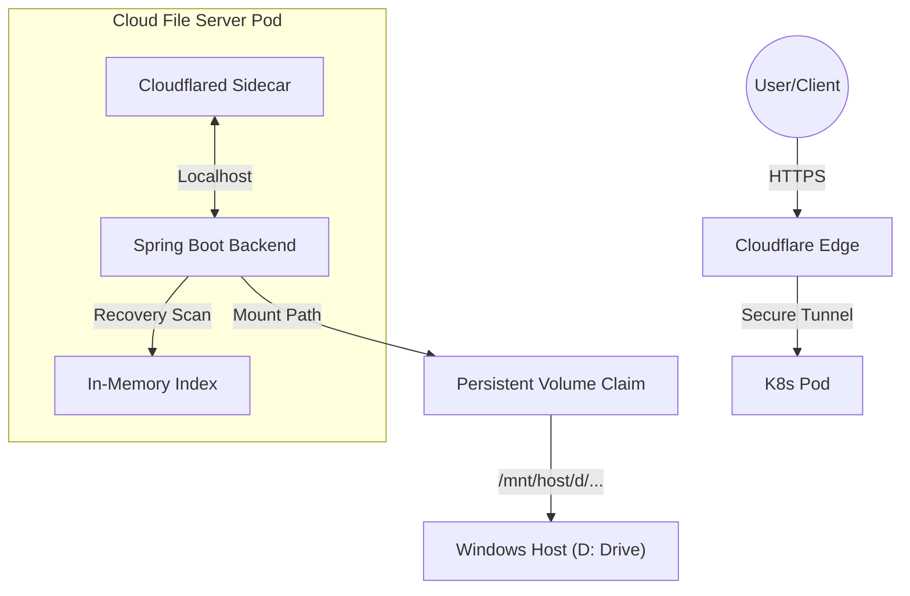

# ☁️ Cloud File Server (v1.0.0)


**A high-performance, containerized personal cloud storage system with automated global tunneling.**

Developed as a results-oriented backend solution, this project demonstrates a modern DevOps approach to the Java ecosystem. It is optimized for both **local development** (standalone) and **scalable cloud deployment** (Kubernetes), bridging the gap between ephemeral containers and persistent host storage.

---

## 🚀 Core Capabilities

| Feature | Description |
| :--- | :--- |
| **Hybrid Execution Engine** | Run as a lightweight, standalone Spring Boot application OR a fully orchestrated Kubernetes service. |
| **Persistent Storage** | **WSL 2 Optimized:** Integrated volume mapping bridges Kubernetes pods directly to the Windows host filesystem (`D:\` drive), ensuring data persists across pod restarts/updates. |
| **Automated Global Access** | Built-in **Cloudflare "Sidecar" tunnel** generates a secure public URL (`https://...`) automatically. No port forwarding or router config required. |
| **Self-Healing Data Index** | Implements a `@PostConstruct` recovery service that scans physical storage on startup to rebuild in-memory file metadata if the cache is lost. |
| **Automated CI/CD** | Full GitHub Actions pipeline: compiles Java source, packages the installer, builds Docker images, and publishes a GitHub Release. |

---

## 🛠️ System Architecture

### Tech Stack
* **Backend:** Java 21 (Eclipse Temurin) / Spring Boot
* **Containerization:** Multi-stage Docker builds
* **Orchestration:** Kubernetes (Deployment, Service, PVC)
* **Networking:** Cloudflare Tunnel (`cloudflared`) via Sidecar pattern

### Traffic Flow & Storage Logic



## 📖 Installation & Usage

### Prerequisites
* **OS:** Windows 10/11 (Required for the specific `D:\` drive mapping features).
* **For Cloud Mode:** Docker Desktop (with WSL 2 Backend enabled).
* **For Local Mode:** Java JDK 21+.

### ⚡ Option 1: For Users (One-Click Setup)
1.  Navigate to the **[Releases](../../releases)** tab on GitHub.
2.  Download `CloudFileServer_Setup.zip`.
3.  Extract the ZIP and run `install.bat`.
    * *This creates a desktop shortcut and prepares the environment.*
4.  Launch the app via the **Desktop Shortcut** and select your mode:
    * **Local:** Runs directly on localhost (Fastest for LAN).
    * **Cloud:** Deploys to Kubernetes with a public HTTPS URL.

### 👨‍💻 Option 2: For Developers (Building from Source)
If you wish to modify the code or contribute:

1.  **Clone the repository:**
    ```bash
    git clone [https://github.com/your-username/cloud-file-server.git](https://github.com/your-username/cloud-file-server.git)
    cd cloud-file-server
    ```

2.  **Build with Maven Wrapper:**
    ```bash
    ./mvnw clean package
    ```

3.  **Docker Build:**
    The multi-stage `Dockerfile` is optimized for caching.
    ```bash
    docker build -t cloud-file-server:latest .
    ```

---

## 📝 Configuration & Storage

By default, the system maps container storage to your Windows host to ensure data safety.

* **Default Container Path:** `/app/data`
* **Default Host Path:** `/mnt/host/d/k8s-data/cloud-file-server-storage`

> **Note:** This path is configurable during the launch sequence via the `launcher.bat` script. If you do not have a `D:\` drive, update the config to point to `C:\` or another volume.

---

## 🎯 Use Cases

* **Personal File Sharing:** Securely share large files with friends by providing them with the automated Cloudflare link.
* **Remote Dev Storage:** Centralized backend for storing assets across multiple machines using the Tailscale VPN or public tunnel.
* **Media Hosting:** Stream media files directly from your physical drive through an encrypted HTTPS link.
* **Learning DevOps:** A reference implementation for Java developers learning how to handle stateful storage and sidecars in Kubernetes.

---

## 🛡️ CI/CD & Security

* **Branch Protection:** The `main` branch is protected against force-pushes.
* **Automated Releases:** Pushing to `main` triggers:
    1.  Java Unit/Integration Tests.
    2.  Docker Image Build & Push.
    3.  Packaging of `InstallerDockerfile`.
    4.  Creation of a new GitHub Release.
